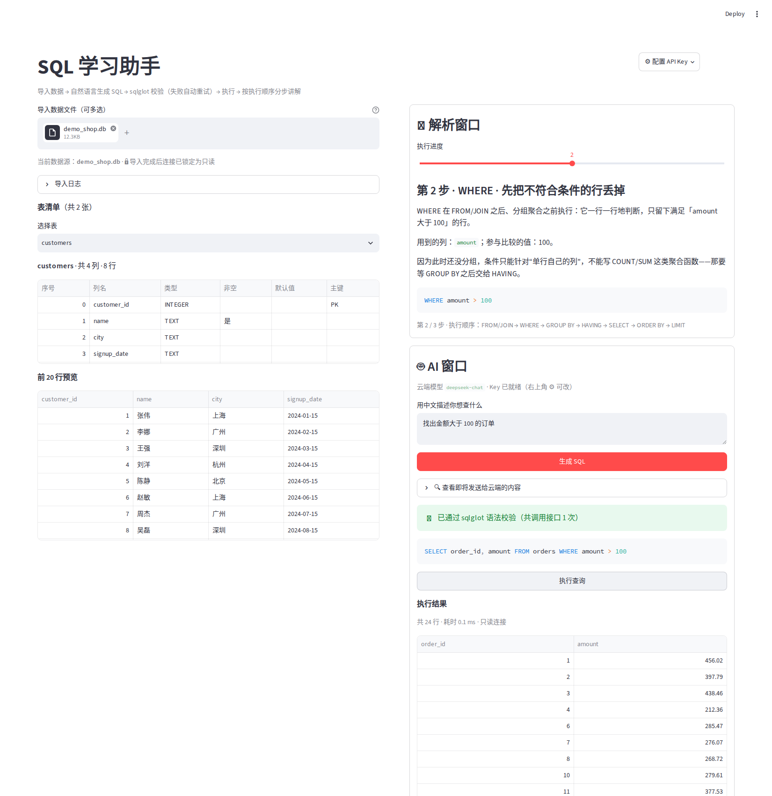

# Stepwise SQL

> **Stepwise SQL** 是一个完全在自己电脑上运行的 SQL 学习助手：导入数据库或 CSV，用一句话说出你想查什么（**中英文皆可**），AI 帮你写成 SQL，再**按数据库真实的执行顺序**一步一步讲清楚这句 SQL 到底在干什么。
>
> 它受 **Python Tutor** 启发，旨在通过 AST 解析将 SQL 分步骤拆解，让学习者看清每一步的执行逻辑——而不是只看到一个最终答案。


> **名字的由来**：`Stepwise`（逐步）+ `SQL`。Python Tutor 让人"看见每一行 Python 是怎么执行的"，Stepwise SQL 想让 SQL 也有同样的体验——一条查询不是一个黑盒，而是 `FROM → WHERE → SELECT` 这些阶段依次发生的**过程**。


---

## 目录

- [一、这个工具是干什么的](#一这个工具是干什么的)
- [二、核心亮点](#二核心亮点)
- [三、界面预览](#三界面预览)
- [四、保姆级安装与运行（零基础请从这一步开始）](#四保姆级安装与运行零基础请从这一步开始)
  - [第 0 步：先搞懂 3 个名词](#第-0-步先搞懂-3-个名词)
  - [第 1 步：安装 Python](#第-1-步安装-python)
  - [第 2 步：获取代码并安装依赖](#第-2-步获取代码并安装依赖)
  - [第 3 步：配置 API Key](#第-3-步配置-api-key)
  - [第 4 步：启动程序](#第-4-步启动程序)
- [五、第一次使用：5 分钟上手](#五第一次使用5-分钟上手)
- [六、项目文件结构](#六项目文件结构)
- [七、安全与隐私](#七安全与隐私)
- [八、常见问题排查（FAQ）](#八常见问题排查faq)
- [九、技术栈与已知限制](#九技术栈与已知限制)
- [十、License](#十license)

---

## 一、这个工具是干什么的

**Stepwise SQL 是一个在你本机浏览器里打开、用自然语言提问就能生成并讲解 SQL 的本地练习工具**——不用装数据库客户端，不用背语法，导入一个 `.db` 文件就能开始练。提问语言不限：中文、英文，甚至中英混写都可以。

它的定位不是"帮你写 SQL 的加速器"，而是"陪你把 SQL 读懂的老师"——**受 Python Tutor 启发，旨在通过 AST 解析将 SQL 分步骤拆解，让学习者看清每一步的执行逻辑**。生成只是第一步，重点在于它会把 `FROM → JOIN → WHERE → GROUP BY → HAVING → SELECT → ORDER BY → LIMIT` 拆成独立的步骤，用大白话告诉你**每一步筛掉了什么、留下了什么、为什么必须是这个顺序**。

> 顺带说一句：**执行顺序和你写 SQL 的顺序并不相同**。你从 `SELECT` 开始写，数据库却是从 `FROM` 开始执行的——这个"反直觉"正是 SQL 初学者最大的坎，也是本项目存在的理由。

---

## 二、核心亮点

| 亮点 | 说明 |
| --- | --- |
| **完全本地运行** | 界面、数据库、SQL 解析全部在你自己电脑上跑，数据不出本机；只有"把自然语言问题翻译成 SQL"这一步会调用云端大模型 |
| **中英文都能问** | Prompt 不绑定单一语言：中文、英文、中英混写都能识别，适合对照英文文档学习或练英文表达 |
| **支持多格式导入** | `.db` / `.sqlite` / `.sqlite3` 数据库文件、`.csv` 表格、`.sql` 建表脚本，拖进去就能用 |
| **表结构一目了然** | 自动列出所有表、每个字段的类型、是否主键、是否非空，并直接预览前 20 行数据，不用写 `PRAGMA` 去猜 |
| **AI 生成 SQL + 双层校验** | 先让大模型生成，再用 `sqlglot` 做语法与安全校验（只允许单条 `SELECT`）；校验不过会把**报错原文回喂给模型**让它自己改，最多重试 2 次 |
| **按执行顺序分步讲解** | 不是"整句翻译"，而是拆成 8 个执行阶段，配 `st.slider` 进度条，可以像看幻灯片一样一步步往前翻 |
| **白话讲解 + 落到具体值** | 讲解里会写“用到 `orders` 表的 `amount` 列，比较的值是 `100`”，而不是干巴巴的“过滤条件” |
| **只读保护，改不坏数据** | 上传的数据库会先复制一份副本，导入完成后立刻 `PRAGMA query_only = ON`，查询时用 URI `mode=ro` 打开，`UPDATE` / `DELETE` / `DROP` 一律被数据库层挡下 |
| **发送内容可审计** | 侧边有个「🔍 查看即将发送给云端的内容」折叠面板，发出去之前你能逐字看到到底传了什么 |
| **密钥零依赖管理** | 根目录 `.env` 文件写 Key，程序自己解析（不需要 `python-dotenv`），并自动把 `.env` 写进 `.gitignore`，防手滑泄露 |

---

## 三、界面预览



> 左侧是数据窗口（导入区、表清单、字段结构、前 20 行预览），右侧上方是解析窗口（执行步骤 + 进度条 + 分步讲解），右侧下方是 AI 窗口（用自然语言提问、生成 SQL、执行并看结果）。

---

## 四、保姆级安装与运行（零基础请从这一步开始）

> 全程大约 **10 分钟**。下面每一步都写了"怎么操作"和"怎么确认自己做对了"。**不要跳步**，尤其是第 1 步和第 3 步。

### 第 0 步：先搞懂 3 个名词

| 名词 | 一句话解释 |
| --- | --- |
| **终端 / 命令行 / cmd** | 一个黑底白字的窗口，你打字、它执行。Windows 上叫「命令提示符」 |
| **项目目录** | 存放本项目所有文件的那个文件夹，比如 `D:\stepwise-sql`。后面所有命令都必须在这个文件夹里执行 |
| **`python -m streamlit run xxx.py`** | 用 Python 去启动 streamlit 这个库，并让它运行 `xxx.py` 这个文件。照着抄就行，不用理解 |

### 第 1 步：安装 Python

1. 打开官网：<https://www.python.org/downloads/>（国内访问慢的话，用浏览器多等一会儿，或者搜索"Python 官网 下载"）。
2. 点击黄色的 **Download Python 3.x.x** 按钮，下载 Windows 安装包。
3. **双击安装包，在第一个界面底部，务必勾选 `Add python.exe to PATH`（旧版本写作 Add Python 3.x to PATH）**。
   👉 这一个勾，决定了你后面会不会遇到“python 不是内部或外部命令”。**这是全文最容易踩的坑，请务必勾上。**
4. 然后点 `Install Now`，等进度条走完，最后点 `Close`。
5. **验证是否装好**：按 `Win + R`，输入 `cmd`，回车，在黑窗口里输入：

   ```bat
   python --version
   ```

   - ✅ 看到 `Python 3.11.x` 这类字样 → 成功，继续下一步。
   - ❌ 看到“python 不是内部或外部命令” → 说明第 3 步的勾没打上。**最简单的补救**：重新运行安装包，选 `Modify` → 一路下一步，确保勾上 `Add python.exe to PATH`；或者直接卸载重装。

> 版本要求：**Python 3.9 及以上**。用 3.11 或 3.12 最稳。

### 第 2 步：获取代码并安装依赖

**2.1 把代码弄到本地（两种方式，选一种）**

- **方式 A（推荐给完全没用过 Git 的人）**：打开本项目的 GitHub 页面 → 点绿色的 `Code` 按钮 → `Download ZIP` → 下载完右键解压，得到一个文件夹。
- **方式 B（装过 Git 的人）**：在你想放项目的目录里打开终端，执行：

  ```bat
  git clone https://github.com/你的用户名/你的仓库名.git
  ```

**2.2 打开终端并进入项目目录**

1. 按 `Win + R`，输入 `cmd`，回车。
2. 用 `cd` 命令切换目录。**注意 `cd` 后面有一个空格，路径带空格要用英文双引号包住**：

   ```bat
   cd /d "D:\stepwise-sql"
   ```

   > `/d` 的作用是允许跨盘符切换（比如从 C 盘跳到 D 盘）。不加 `/d` 时，在 C 盘里 `cd D:\xxx` 是不生效的——这也是新手常犯的错。
   >
   > **不知道路径怎么写？** 打开项目文件夹，点一下上方地址栏，路径会变成可复制的文本，`Ctrl+C` 复制，然后在 cmd 里右键粘贴。
3. **确认自己站对地方了**：

   ```bat
   dir
   ```

   如果列出的文件里有 `app_cloud.py`、`requirements.txt`，说明目录对了。**没有就先别往下走，路径错了后面全是错。**

**2.3 安装依赖**

```bat
pip install -r requirements.txt
```

等它下载安装（1～3 分钟）。看到 `Successfully installed streamlit-... pandas-... sqlglot-...` 就是成功了。

- **下载很慢 / 卡住不动？** 换成国内镜像再试：

  ```bat
  pip install -r requirements.txt -i https://pypi.tuna.tsinghua.edu.cn/simple
  ```

- **提示 `pip 不是内部或外部命令`？** 说明 Python 没进 PATH，回到第 1 步第 3 点补救；临时可用 `python -m pip install -r requirements.txt`。

本项目只依赖 3 个第三方库：`streamlit`、`pandas`、`sqlglot`。其他用到的 `sqlite3`、`urllib`、`json`、`os`、`pathlib` 都是 Python 自带的，**不用另外装**。

### 第 3 步：配置 API Key

程序需要调用一个"OpenAI 兼容接口"的大模型来把自然语言需求翻译成 SQL。默认对接的是 **DeepSeek**（`https://api.deepseek.com/v1`，模型 `deepseek-chat`），因为它便宜、中英文都稳、注册简单。

**3.1 先去申请一个 Key（以 DeepSeek 为例）**

1. 打开 <https://platform.deepseek.com/>，注册并登录。
2. 左侧菜单点 **API keys** → **创建 API key** → 起个名字（随便，比如 `stepwise-sql`）。
3. 复制那串 `sk-` 开头的字符。**它只会完整显示一次**，先粘到记事本里存着。
4. 到 **充值** 页面充一点点钱（几块钱就够练很久）。**余额为 0 时接口会报 402，别以为是程序坏了。**

**3.2 在项目里创建 `.env` 文件**

项目里有一个 `.env.example` 模板文件（如果没有，**先启动一次程序**，它会自动生成）。

1. 打开项目文件夹。
2. **先让文件后缀可见**（不然你会造出 `.env.txt` 这种假文件）：
   - Win 11：资源管理器顶部 **查看** → **显示** → 勾选 **文件扩展名**。
   - Win 10：顶部 **查看** 选项卡 → 勾选 **文件扩展名**。
3. 右键 `.env.example` → **复制** → 在同一文件夹 **粘贴** → 得到一个 `.env - 副本.example`。
4. 右键它 → **重命名** → 把名字整个改成 `.env`（把 `.example` 那段删掉），回车，系统提示"改变文件扩展名可能导致文件不可用"→ 点 **是**。
   > ⚠️ 判断成功的标志：文件名**正好是** `.env`，图标变成一个白色的未知文件图标。如果显示成 `.env.txt`，说明后缀没显示出来，你改错了——重新按第 2 点打开扩展名再改名。
5. 右键 `.env` → **打开方式** → **记事本**。
6. 把里面的内容改成你自己的 Key（`=` 两边不要加空格，Key 不要加引号）：

   ```ini
   OPENAI_API_KEY=sk-你复制到的那串字符
   ```

7. `Ctrl + S` 保存，关掉记事本。

> 📌 **改完 `.env` 必须重启程序才生效**（`.env` 是在启动时读进内存的）。已经在跑的，回 cmd 窗口按 `Ctrl + C` 停掉，再重新启动。

**3.3 换成别的大模型服务商（可选）**

`.env` 里只放 Key；接口地址和模型名写在 `app_cloud.py` 顶部的常量区（大约第 91～93 行）：

```python
API_KEY = os.environ.get("OPENAI_API_KEY", "").strip()
BASE_URL = "https://api.deepseek.com/v1"    # 接口前缀，换服务商就改这里
MODEL_NAME = "deepseek-chat"                # 模型名，换服务商就改这里
```

只要对方提供 **OpenAI 兼容接口**（`/chat/completions`），改这两行即可，例如：

| 服务商 | BASE_URL | MODEL_NAME 示例 |
| --- | --- | --- |
| DeepSeek（默认） | `https://api.deepseek.com/v1` | `deepseek-chat` |
| 阿里云百炼（通义千问） | `https://dashscope.aliyuncs.com/compatible-mode/v1` | `qwen-plus` |
| 月之暗面（Kimi） | `https://api.moonshot.cn/v1` | `moonshot-v1-8k` |
| OpenAI | `https://api.openai.com/v1` | `gpt-4o-mini` |

> 注意：Key 要和 BASE_URL 是**同一家**的，混用会报 401。

**3.4 不想建 `.env` 也行（临时方案）**

启动后点右上角 **⚙️ 配置 API Key**，把 Key 粘进去，只对当前这次会话有效，关掉浏览器就没了，不会写进任何文件。

### 第 4 步：启动程序

**方式 A：双击（Windows 推荐）**

直接双击项目里的 **`启动StepwiseSQL.bat`**。它会自动做三件事：切到脚本所在目录 → 检查 Python 和依赖（缺了就自动装）→ 启动服务。

**方式 B：命令行（Mac / Linux 用这个）**

在项目目录里执行：

```bat
python -m streamlit run app_cloud.py
```

> Mac / Linux 把 `python` 换成 `python3`。

**启动成功的标志**：终端里出现类似下面的内容，并且浏览器**自动弹出**页面：

```
  You can now view your Streamlit app in your browser.
  Local URL: http://localhost:8501
```

- 没自动弹？手动在浏览器地址栏输入 **<http://localhost:8501>**。
- **第一次启动**可能提示 `Welcome to Streamlit! ... Email:`，直接**按回车跳过**即可。
- **想停止**：回到终端窗口按 `Ctrl + C`，或直接关掉那个黑窗口。
- **下次再开**：重复本步骤即可，不用重新装依赖。

---

## 五、第一次使用：5 分钟上手

项目自带一个练习库 `demo_shop.db`（`customers` 8 行客户、`orders` 30 行订单），跟着做一遍就全会了：

1. **导入数据**：左上「导入数据文件」→ 把 `demo_shop.db` 拖进去 → 下方出现"表清单（共 2 张）"和"前 20 行预览"。
2. **看一眼结构**：下拉框选 `customers`，能看到 `customer_id`（主键）、`name`、`city`、`signup_date` 四列的类型。
3. **用一句话提问（中英文都可以）**：右下「AI 窗口」输入框里写一句话，例如：
   - `找出金额大于 100 的订单`
   - `每个城市的客户数量，按人数从多到少排序`
   - `2024 年 3 月以后下单的客户姓名和订单金额`
   - `Find customers from Shanghai with at least one order`（英文同样可以）
4. **点「生成 SQL」**：稍等 2～5 秒，下方会出现绿色提示"已通过 sqlglot 语法校验（共调用接口 N 次）"和生成的 SQL。如果第一次生成的不合格，程序会自动把报错回喂重试，最多 2 次。
5. **看讲解**：右上「解析窗口」出现"第 1 步 / 共 N 步"。拖动**执行进度**滑块，或点步骤数字，逐步看每一步在做什么；每一步的代码片段下方就是白话解释。
6. **点「执行查询」**：AI 窗口下方出现结果表格、总行数、耗时，以及"只读连接"标记。
7. **想确认发了什么？** 展开「🔍 查看即将发送给云端的内容」，你会看到发出去的只有表名、列名、类型。

---

## 六、项目文件结构

```
stepwise-sql/
├── app_cloud.py          # 入口与界面：常量区、.env 引导、API 调用、三个面板的 UI
├── data_layer.py         # 数据层：导入（含 CSV / .sql）、只读连接、schema 生成、执行与报错翻译
├── explainers.py         # 解析层：sqlglot 校验、8 个执行步骤的讲解函数、中文表达式翻译
├── requirements.txt      # 第三方依赖清单
├── README.md             # 本文件
├── .env.example          # 密钥模板（可上传，里面只有占位符）
├── .env                  # 你的真实密钥（自动生成 / 手动创建，已被 .gitignore 忽略，不会上传）
├── .gitignore            # 版本库忽略规则
├── 启动StepwiseSQL.bat    # Windows 一键启动脚本
└── demo_shop.db          # 练习用示例数据库
```

三个 Python 文件的分工是刻意切开的：**改界面只动 `app_cloud.py`，改数据库逻辑只动 `data_layer.py`，改讲解文案只动 `explainers.py`**，互不干扰。

---

## 七、安全与隐私

这一节请务必读完，它决定了你能不能放心把这个项目传到 GitHub。

**1. 什么不会被上传**

`.gitignore` 已经写好规则，以下内容**永远进不了 Git 仓库**：

| 内容 | 为什么排除 |
| --- | --- |
| `.env` | 里面有你的真实 API Key。**公开仓库泄露 Key，别人可以直接刷你的余额** |
| `*.db` / `*.sqlite` / `*.sqlite3` | 本地数据库可能含真实业务数据、客户信息 |
| `__pycache__/`、`*.pyc` | Python 运行时缓存，没有版本意义 |

> 唯一的例外是练习库 `demo_shop.db`——它是虚构数据，写在 `.gitignore` 的 `!demo_shop.db` 白名单里，跟着仓库一起发布，方便新手直接上手。

**2. 上传前 30 秒自检（强烈建议做一次）**

```bat
git status
git check-ignore -v .env
```

- 第一条命令的输出里**不应该出现 `.env`**（如果出现了，说明它已被 Git 跟踪，需要 `git rm --cached .env` 再提交）。
- 第二条命令如果打印出 `.env` 和对应的忽略规则，说明忽略生效。

**3. 发给云端大模型的到底是什么**

**只有表结构（Schema），没有任何一行具体数据。** 拼给模型的内容长这样：

```
数据库结构（SQLite）：
表 customers(customer_id INTEGER 主键, name TEXT, city TEXT, signup_date TEXT)
表 orders(order_id INTEGER 主键, customer_id INTEGER, amount REAL, order_date TEXT)
```

表名、列名、类型，仅此而已。**客户的姓名、订单金额这些具体值，一个都不会发出去。**

每一条发给云端的消息你都能在「🔍 查看即将发送给云端的内容」里逐字核对——这是刻意做的审计入口，不是装饰。

**4. 数据只读，改不坏**

- 上传的 `.db` 文件会被**读成字节后写成一个副本**再使用，**原文件不会被修改**（连修改时间都不变）。
- 导入完成后立刻执行 `PRAGMA query_only = ON`；查询时用 `file:...?mode=ro` 的只读 URI 打开，并在 `finally` 里关闭连接。
- 后果是：`UPDATE` / `DELETE` / `DROP` 全部会失败并提示"当前是只读连接"。**这是设计，不是 bug。**

**5. Key 存在哪**

- 写在 `.env` 里：明文存在你本机磁盘（和任何本地配置文件一样），不进 Git。
- 在弹窗里手输：只存在内存（`st.session_state`），关掉即消失，**不落盘、不回显**。

---

## 八、常见问题排查（FAQ）

### Q1. 提示 `python 不是内部或外部命令` / `'python' 不是内部或外部命令，也不是可运行的程序`

Python 没装，或者装了但没加入 PATH。

- 先装/修：重新运行 Python 安装包 → `Modify` → 确保勾上 `Add python.exe to PATH`。
- 验证：`python --version` 能打印版本号即可。
- 应急写法：把命令里的 `python` 换成 `py`，例如 `py -m streamlit run app_cloud.py`。
- 还不行就卸载 Python 重装，安装第一屏**务必勾选那个 PATH 选项**。

### Q2. 浏览器打不开 / `localhost:8501` 一直转圈 / 显示"无法访问此网站"

按顺序排查：

1. **看终端窗口还在不在**：黑窗口被关掉，服务就停了。重新启动即可。
2. **确认端口**：终端里写的可能是 `8501`，也可能是别的（比如 8502，说明 8501 被占了），以终端打印的 `Local URL` 为准。
3. **端口被占用**：`netstat -ano | findstr 8501` 找到占用进程的 PID，在任务管理器里结束它；或者直接换端口启动：

   ```bat
   python -m streamlit run app_cloud.py --server.port 8502
   ```

4. **代理 / VPN 干扰**：关掉系统代理或 VPN 再试，或把 `localhost` 加入代理白名单。
5. **换浏览器**：用 Chrome / Edge，别用公司内网定制版浏览器。

### Q3. 终端一启动就报错 `ModuleNotFoundError: No module named 'streamlit'`

依赖没装，或者装到了另一个 Python 里（电脑上装了多个 Python 时很常见）。

```bat
python -m pip install -r requirements.txt
```

用 `python -m pip` 而不是裸 `pip`，可以保证"装给当前这个 python"。装完用 `python -c "import streamlit, pandas, sqlglot; print('ok')"` 验证。

### Q4. `.env` 明明写了 Key，界面还是提示"未配置"

四种常见原因，逐条对：

| 现象 | 原因 | 解决 |
| --- | --- | --- |
| 文件名是 `.env.txt` | 系统隐藏了扩展名，改名时多加了 `.txt` | 打开"显示文件扩展名"，改回 `.env` |
| 程序是在改之前启动的 | `.env` 只在启动时读取 | `Ctrl + C` 停掉，重新启动 |
| 写成了 `OPENAI_API_KEY = sk-xxx`（等号两边有空格） | 解析器会保留空格 | 改成 `OPENAI_API_KEY=sk-xxx` |
| 复制时带了中文引号 `“”` | 不被识别 | 用英文引号或干脆不加引号 |

另外，**系统环境变量里已经有同名变量**时，会优先用系统的（这是刻意设计，方便临时覆盖）。排查：

```bat
echo %OPENAI_API_KEY%
```

打印出旧值就先清掉系统变量。

### Q5. 生成 SQL 时提示 `401` / `403`

Key 错了、过期了，或者 **Key 和 BASE_URL 不是同一家服务商**（比如用 DeepSeek 的 Key 去请求 OpenAI 的地址）。核对 `.env` 里的 Key 与 `app_cloud.py` 里的 `BASE_URL` 是否配套。

### Q6. 提示 `402` / `Insufficient Balance`

账户余额不足。去服务商控制台充值（DeepSeek 充几块钱能用很久）。这不是程序问题。

### Q7. 提示 `404` / `接口路径不存在`

`BASE_URL` 少了或多了 `/v1`。正确形式是 `https://api.deepseek.com/v1`（末尾不带 `/chat/completions`，那部分由程序自动拼）。报错信息里会打印实际请求的完整 URL，照着对照。

### Q8. 一直转圈，最后报"连接超时"

网络到不了服务商，或者响应太慢。

- 检查代理 / 防火墙；
- 换个网络（手机热点）试试；
- 想放宽等待时间，改 `app_cloud.py` 里的 `API_TIMEOUT`（默认 120 秒）。

### Q9. 双击 `启动StepwiseSQL.bat` 黑窗口一闪就没了

说明它执行到某一步出错了。

1. 不要双击，改成：按 `Win + R` → `cmd` → 把 bat 拖进窗口 → 回车。这样窗口不会关，能看到具体报错。
2. 常见原因：没装 Python（脚本会提示）、不在项目目录（脚本会提示找不到 `app_cloud.py`）。
3. 如果 bat 不在项目文件夹里，右键它 → 编辑，把 `cd /d "%~dp0"` 改成你的真实路径。

### Q10. 导入 CSV 后中文变成乱码

CSV 的编码不是 UTF-8（Excel 导出的中文 CSV 常是 GBK）。用记事本打开该 CSV → **另存为** → 编码选 **UTF-8** → 覆盖保存，再重新导入。

### Q11. 导入 CSV 后列名很奇怪，或者多了一列 `Unnamed: 0`

那是 Excel 导出时带上的索引列，属于正常现象；也可以先在 Excel 里删掉第一列再导入。列名里的空格、中文括号建议改干净，AI 生成 SQL 时更不容易出错。

### Q12. 执行查询时提示"当前是只读连接，写操作被拒绝"

**这是安全设计。** 本工具只让你练查询，不允许改数据，所以连接是只读的。想练 `INSERT` / `UPDATE`，请用 DB Browser for SQLite 之类的工具在**副本**上操作。

### Q13. 生成的 SQL 报"no such column" / "no such table"

- 模型编了不存在的字段：把问题说得更具体，比如"用 `orders` 表的 `amount` 列"；
- 也可能是你选了表但问题问的是另一张表，检查左侧"选择表"下拉框；
- 换一个更强的模型（改 `MODEL_NAME`）通常更稳。

### Q14. 讲解只有 1～2 步，感觉没讲全

步骤是按**实际出现的子句**生成的：一句 `SELECT * FROM t` 本来就只有 `FROM` 和 `SELECT` 两步。想要完整 8 步，问一个带 `WHERE` + `GROUP BY` + `HAVING` + `ORDER BY` + `LIMIT` 的问题，比如"每个城市客户数超过 1 人的城市和人数，按人数降序取前 3 个"。

### Q15. Mac / Linux 怎么跑

```bash
python3 -m pip install -r requirements.txt
python3 -m streamlit run app_cloud.py
```

`.bat` 是 Windows 专用，Mac / Linux 用上面两行命令即可，其余步骤（`.env` 配置）完全一样。

### Q16. 怎么彻底卸载

关掉程序 → 删除整个项目文件夹 → （可选）`python -m pip uninstall streamlit pandas sqlglot`。本工具不写注册表、不装系统服务、不在项目目录外留文件。

---

## 九、技术栈与已知限制

| 库 | 用途 |
| --- | --- |
| `streamlit` | 整个网页界面（布局、表格、滑块、弹窗） |
| `pandas` | 预览与查询结果的表格化展示 |
| `sqlglot` | SQL 解析与校验：判断是不是单条 `SELECT`、提取 AST 生成讲解 |
| `sqlite3` / `urllib` / `json` / `os` / `pathlib` | Python 标准库，分别负责数据库、HTTP 请求、数据序列化、环境变量、路径处理 |

**设计上的边界（不是 bug）：**

- **只支持单条 `SELECT`**：`INSERT` / `UPDATE` / `DELETE` / DDL 会被 `sqlglot` 校验直接拦下。
- **不处理嵌套子查询与 CTE**：`WITH ... AS`、`(SELECT ...)` 这类写法能执行，但讲解只会按最外层结构拆步骤，不保证逐层覆盖。
- **SQL 方言固定为 SQLite**：`DATE_FORMAT`、`ILIKE` 这类别的数据库的函数不支持。
- **结果最多取 1000 行**：防止一次拖回百万行把页面卡死。需要全量请自己加聚合或直接连数据库。
- **不做 SQL 语法高亮编辑器**：输入框就是普通文本框，专心练"想清楚再写"。
- **云端模型质量决定生成质量**：工具负责校验与讲解，不保证生成的 SQL 一定符合你的本意——读懂讲解再执行，才是这个工具的正确用法。

---

## 十、License

MIT License，随便用、随便改。如果它对你有帮助，给个 ⭐ 就好。
